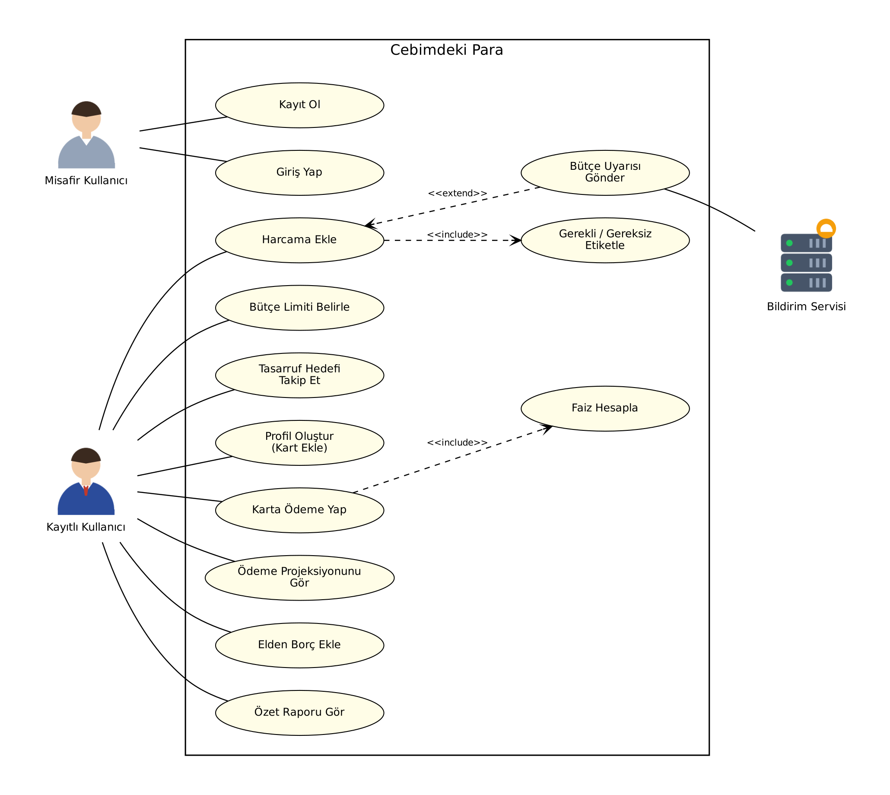
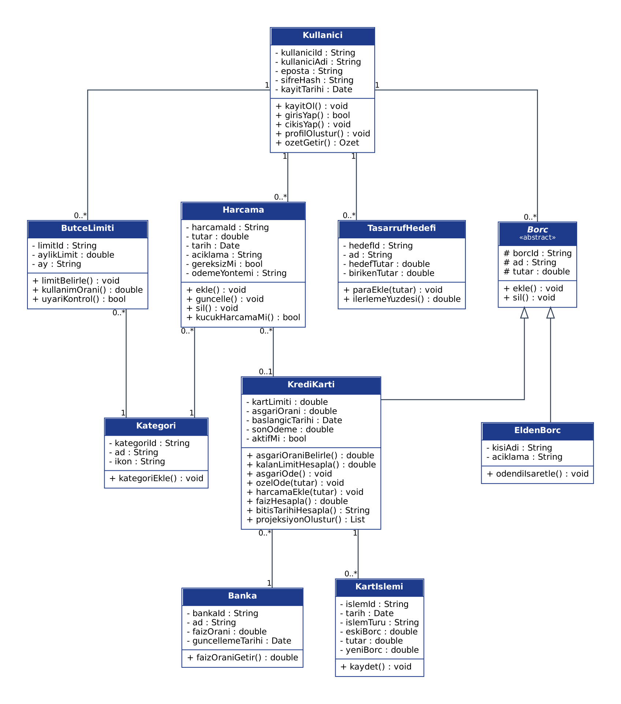
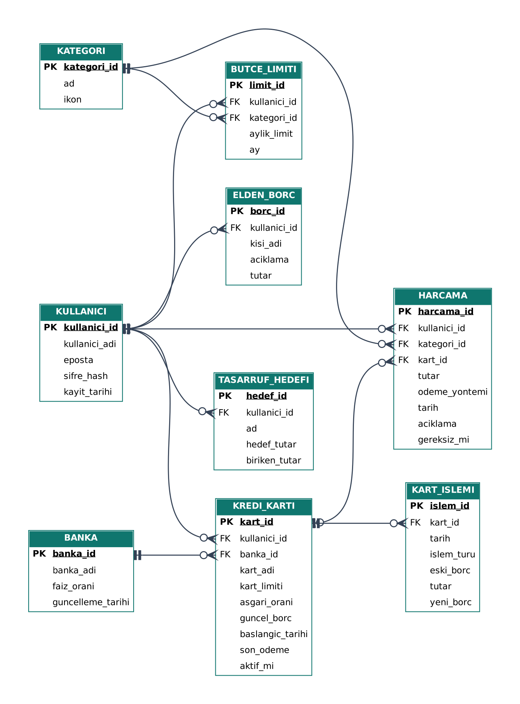
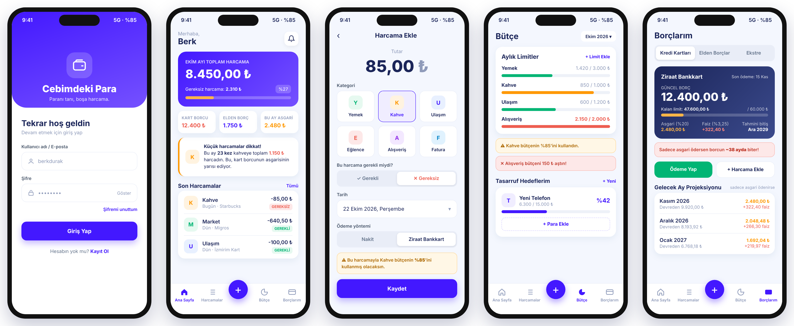

Teslim Tarihi: 23.10.2026

# Ege Üniversitesi
### Tire Kutsan Meslek Yüksekokulu – Bilgisayar Programcılığı
### Proje Dersi Raporu

**PROJE ADI:** Cebimdeki Para

**GITHUB REPO URL:** https://github.com/berkdurak/proje

**ÖĞRENCİ BİLGİLERİ:**
1. 60250000050 - Mehmet Berk Durak
2. 60250000025 - Süleyman Aslan

---

## A. Sistem Gereksinimleri

### 1. Projenin Amacı ve Kapsamı (Scope)

**Bu sistem hangi problemi çözüyor?**

Kahve, atıştırmalık gibi küçük harcamalar tek tek bakınca önemsiz görünüyor ama ay sonunda toplandığında ciddi bir para tutuyor. Kredi kartı kullananların çoğu da sadece asgari tutarı ödüyor ve kalan borcun faizle her ay büyüdüğünü fark etmiyor. Biz de bu iki sorunu tek bir yerde çözmek için Cebimdeki Para adında bir mobil uygulama yapmaya karar verdik. Amacımız kullanıcının parasının nereye gittiğini görmesini ve parasını daha verimli kullanmasını sağlamak.

**Sistem ne yapacak?**

- Kullanıcı adı ve şifreyle kayıt olma ve giriş yapma
- Kayıttan sonra profil oluştururken kredi kartını bankası ve limitiyle ekleme
- Harcamaları tutar, kategori, tarih ve ödeme yöntemiyle (nakit ya da kredi kartı) kaydetme, her harcamayı "gerekli" ya da "gereksiz" diye işaretleme
- Ay sonunda gereksiz harcamaların ve küçük harcamaların toplamını gösterme
- Kategoriye göre aylık bütçe limiti koyma, limite yaklaşınca uyarı verme
- Tasarruf hedefi oluşturup ne kadar biriktiğini takip etme
- Kartla yapılan harcamalardan kartın borcunu oluşturma; asgari tutarı kartın limitine göre, faizi bankanın oranına göre otomatik hesaplama
- Kartta harcanmamış kalan limiti gösterme
- Karta asgari ya da istenen tutarda ödeme girme, kalan borca bankanın faiz oranını ekleyip yeni borcu hesaplama
- Borcun tahmini bitiş tarihini ve sonraki ayların ödeme planını gösterme
- Arkadaştan alınan borçları (elden borç) ayrıca kaydetme

**Sistem ne yapmayacak? (Kapsam dışı)**

- Bankalara bağlanmayacak, bütün bilgiler kullanıcı tarafından elle girilecek.
- Uygulama üzerinden gerçek ödeme ya da para transferi yapılmayacak.
- Faiz oranları bankalardan anlık olarak çekilmeyecek. Uygulamadaki banka faiz oranları ve asgari ödeme kuralları, Merkez Bankası ve BDDK kararları değiştikçe tarafımızdan güncellenecek.
- Yatırım, döviz, hisse takibi gibi özellikler olmayacak.

### 2. Kullanıcı Profilleri / Aktörler

| Aktör | Yetki |
|---|---|
| Misafir Kullanıcı | Sadece kayıt olma ve giriş yapma ekranlarını görebilir. |
| Kayıtlı Kullanıcı | Kendi harcamalarını, bütçesini, tasarruf hedeflerini ve borçlarını ekleyebilir, düzenleyebilir, silebilir. Başkasının verisini göremez. |

Uygulama kişisel kullanım için olduğu ve herkes sadece kendi verisini gördüğü için admin rolüne gerek görmedik.

### 3. Fonksiyonel Gereksinimler

**Persona:** Uygulamanın hedef kullanıcısı; kredi kartı kullanan, ay sonunda parasının nereye gittiğini bilemeyen ve küçük harcamalarını kontrol etmekte zorlanan öğrenci ya da genç çalışan.

User story'leri 4 ana başlık (epic) altında topladık. Her story'nin yanına, o özelliğin tamamlanmış sayılması için gereken kabul kriterlerini yazdık.

**Epic 1: Hesap ve Profil**

| No | User Story | Kabul Kriterleri |
|---|---|---|
| 1 | Bir misafir kullanıcı olarak, hesap oluşturmak istiyorum, böylece verilerimi saklayabileyim. | Kullanıcı adı ve şifre girilerek kayıt olunabilir. Aynı kullanıcı adı ikinci kez alınamaz. Şifre en az 8 karakter olmalıdır. |
| 2 | Bir yeni kullanıcı olarak, kayıt olduktan sonra profilime kredi kartımı bankası ve limitiyle eklemek istiyorum, böylece uygulama borcumu baştan takip etmeye başlasın. | Kayıttan sonra profil oluşturma ekranı açılır. Banka listeden seçilir, kart limiti girilir. Kullanıcı birden fazla kart ekleyebilir, bu adımı atlayıp sonra profilden de ekleyebilir. |
| 3 | Bir kayıtlı kullanıcı olarak, hesabıma giriş ve çıkış yapmak istiyorum, böylece verilerimi sadece ben görebileyim. | Doğru bilgilerle giriş yapılınca ana sayfa açılır. Yanlış bilgide hata mesajı çıkar. Çıkış yapınca giriş ekranına dönülür. |

**Epic 2: Harcama Takibi**

| No | User Story | Kabul Kriterleri |
|---|---|---|
| 4 | Bir kayıtlı kullanıcı olarak, harcamalarımı kaydetmek istiyorum, böylece paramın nereye gittiğini görebileyim. | Tutar, kategori, tarih ve ödeme yöntemi (nakit / kredi kartı) girilerek harcama kaydedilir. Tutar boş ya da negatifse kayıt yapılmaz. Harcama listede hemen görünür. |
| 5 | Bir kayıtlı kullanıcı olarak, harcamalarımı gerekli ya da gereksiz diye ayırmak istiyorum, böylece ne kadar boşa harcadığımı fark edeyim. | Her harcamada gerekli/gereksiz seçimi yapılır. Ana sayfada o ayki gereksiz harcamaların toplamı gösterilir. |
| 6 | Bir kayıtlı kullanıcı olarak, küçük harcamalarımın toplamını görmek istiyorum, böylece önemsiz sandığım harcamaların ne kadar tuttuğunu anlayayım. | Belirlenen tutarın altındaki harcamalar ayrıca toplanır. Ana sayfada kaç kez ve toplam ne kadar harcandığı gösterilir. |
| 7 | Bir kayıtlı kullanıcı olarak, harcamalarımı kategoriye ve aya göre filtrelemek istiyorum, böylece en çok neye para harcadığımı göreyim. | Kategori ya da ay seçilince sadece o harcamalar listelenir. Filtrelenen harcamaların toplamı gösterilir. |

**Epic 3: Bütçe ve Tasarruf**

| No | User Story | Kabul Kriterleri |
|---|---|---|
| 8 | Bir kayıtlı kullanıcı olarak, kategorilere aylık harcama sınırı koymak istiyorum, böylece belli şeylere fazla para harcamayayım. | Her kategori için ayrı limit girilebilir. Limitin ne kadarının kullanıldığı yüzde olarak gösterilir. |
| 9 | Bir kayıtlı kullanıcı olarak, harcama sınırıma yaklaşınca haberdar olmak istiyorum, böylece harcamamı zamanında durdurabileyim. | Limitin %80'ine gelince uyarı verilir. Limit aşılınca ne kadar aşıldığı gösterilir. |
| 10 | Bir kayıtlı kullanıcı olarak, birikim hedefi koymak istiyorum, böylece para biriktirmek için motive olayım. | Hedef adı ve tutarı girilebilir. Para eklendikçe hedefin yüzde kaçına ulaşıldığı gösterilir. |

**Epic 4: Borç Takibi**

| No | User Story | Kabul Kriterleri |
|---|---|---|
| 11 | Bir kayıtlı kullanıcı olarak, kartla yaptığım harcamaların borcuma otomatik eklenmesini istiyorum, böylece asgari ödeme ve faiz tutarımı ayrıca hesaplamak zorunda kalmayayım. | Kartla ödenen harcama kartın borcuna eklenir. Asgari tutar, limit 100.000 TL ve altındaysa borcun %20'si, üstündeyse %40'ı olarak hesaplanır. Faiz, kartın bankasına ait oranla hesaplanır. |
| 12 | Bir kayıtlı kullanıcı olarak, kartımda harcamadığım kalan limiti görmek istiyorum, böylece daha ne kadar harcayabileceğimi bileyim. | Her kart için kalan limit (limit − borç) gösterilir. Kartla harcama yapıldıkça kalan limit düşer, ödeme yapıldıkça artar. |
| 13 | Bir kayıtlı kullanıcı olarak, kredi kartı borcuma yaptığım ödemeleri kaydetmek istiyorum, böylece kalan borcumu faiziyle birlikte bileyim. | Asgari ya da istenen tutarda ödeme girilebilir. Kalan borca kartın bankasına ait faiz oranı eklenerek yeni borç hesaplanır. İşlem geçmişe kaydedilir. |
| 14 | Bir kayıtlı kullanıcı olarak, borcumun ne zaman biteceğini görmek istiyorum, böylece ödemelerimi planlayabileyim. | Her kart için tahmini bitiş tarihi gösterilir. Gelecek 12 ayın ödeme ve faiz tablosu listelenir. Ödeme faizi karşılamıyorsa uyarı verilir. |
| 15 | Bir kayıtlı kullanıcı olarak, arkadaşlarımdan aldığım borçları kaydetmek istiyorum, böylece kime ne kadar borcum olduğunu unutmayayım. | Kişi adı, açıklama ve tutar girilerek borç kaydedilir. Ödenen borç listeden silinebilir. Toplam elden borç ana sayfada gösterilir. |

### 4. Fonksiyonel Olmayan Gereksinimler

- **Güvenlik:** Şifreler veritabanında açık şekilde değil, hash'lenerek saklanacak (bunu Firebase Authentication yapıyor). Her kullanıcı sadece kendi verilerine erişebilecek.
- **Performans:** Ekranlar 2 saniye içinde açılacak, faiz ve borç hesaplamaları anında gösterilecek.
- **Kullanılabilirlik:** Arayüz Türkçe olacak, bir harcama birkaç dokunuşla eklenebilecek. Silme işlemlerinden önce onay sorulacak.
- **Uyumluluk:** Uygulama Android 8.0 ve üzerinde çalışacak, farklı ekran boyutlarına uyum sağlayacak.
- **Veri güvenliği:** Silinen kartların eski işlemleri kaybolmayacak, internet kesilse bile girilen veri kaybolmayacak.

### 5. Harici Arayüz Gereksinimleri

| Servis | Ne için kullanılacak |
|---|---|
| Firebase Authentication | Kayıt olma ve giriş yapma |
| Cloud Firestore | Kullanıcı verilerini bulutta saklama |

Bütçe uyarıları ve ödeme hatırlatmaları dışarıdaki bir servis yerine telefonun kendi bildirim sistemiyle gösterilecek. Ödeme sistemi, banka entegrasyonu veya SMS doğrulama kullanılmayacak.

---

## B. Dizayn Raporu

### 1. Kullanım Senaryoları (Use-Case)

**UC-01: Giriş Yap**

| | |
|---|---|
| **Açıklama** | Kullanıcının hesabıyla uygulamaya giriş yapması. |
| **Birincil Aktör** | Misafir Kullanıcı |
| **Amaç** | Kullanıcının kendi verilerine ulaşması. |
| **Paydaşlar** | Kullanıcı, uygulama ekibi |
| **Ön Koşul** | Kullanıcının daha önce oluşturduğu bir hesabı var ve internet bağlantısı açık. |
| **Tetikleyici** | Kullanıcı uygulamayı açar. |
| **Son Koşul** | Kullanıcı ana sayfada kendi verilerini görür. |

**Temel Akış:**

1. Kullanıcı uygulamayı açar, giriş ekranı gelir.
2. Kullanıcı adını ve şifresini yazar.
3. "Giriş Yap" butonuna basar.
4. Sistem bilgileri kontrol eder.
5. Ana sayfa açılır.

**Alternatif Yol:**

1. Kullanıcı adı veya şifre yanlışsa sistem hata mesajı gösterir.
2. Kullanıcı bilgilerini tekrar girer.
3. Hesabı yoksa "Kayıt Ol" bağlantısıyla kayıt ekranına geçer.

**UC-02: Harcama Ekle**

| | |
|---|---|
| **Açıklama** | Kullanıcının yaptığı bir harcamayı uygulamaya kaydetmesi. |
| **Birincil Aktör** | Kayıtlı Kullanıcı |
| **Amaç** | Paranın nereye gittiğini ve gereksiz harcamaları görmek. |
| **Paydaşlar** | Kullanıcı, Bildirim Servisi |
| **Ön Koşul** | Kullanıcı giriş yapmış. |
| **Tetikleyici** | Kullanıcı bir harcama yapar ve kaydetmek ister. |
| **Son Koşul** | Harcama kaydedilir; aylık toplam, bütçe durumu ve kartla ödendiyse kart borcu güncellenir. |

**Temel Akış:**

1. Kullanıcı "+" butonuna basar.
2. Tutarı yazar ve kategori seçer.
3. Harcamayı "gerekli" ya da "gereksiz" olarak işaretler.
4. Ödeme yöntemini (nakit ya da kredi kartı) seçer ve "Kaydet" butonuna basar.
5. Sistem harcamayı kaydeder ve ana sayfadaki toplamları günceller.
6. Kartla ödendiyse tutar kartın borcuna eklenir; asgari tutar, faiz ve kalan limit yeniden hesaplanır.

**Alternatif Yol:**

1. Kategori bütçesinin %80'i geçildiyse sistem uyarı gösterir.
2. Limit aşıldıysa ne kadar aşıldığı gösterilir.
3. Tutar boş ya da negatifse hata mesajı çıkar, kayıt yapılmaz.
4. Kartla girilen tutar kalan limitten fazlaysa sistem "Limit yetersiz" uyarısı gösterir.

**UC-03: Kredi Kartına Ödeme Yap**

| | |
|---|---|
| **Açıklama** | Kullanıcının kredi kartına yaptığı ödemeyi uygulamaya girmesi. |
| **Birincil Aktör** | Kayıtlı Kullanıcı |
| **Amaç** | Ödemeden sonra kalan borcu faiziyle görmek ve borcun ne zaman biteceğini öğrenmek. |
| **Paydaşlar** | Kullanıcı |
| **Ön Koşul** | Kullanıcının kayıtlı en az bir kredi kartı var. |
| **Tetikleyici** | Kullanıcı kart borcunu öder. |
| **Son Koşul** | Yeni borç hesaplanır, işlem geçmişe eklenir, bitiş tarihi güncellenir. |

**Temel Akış:**

1. Kullanıcı "Borçlarım" ekranından kartı seçer.
2. "Asgari Öde" seçeneğini seçer.
3. Sistem kartın limitine göre belirlenen asgari tutarı (%20 ya da %40) borçtan düşer.
4. Kalan borca kartın bankasına ait faiz oranını ekleyip yeni borcu hesaplar.
5. Yeni borç ve tahmini bitiş tarihi gösterilir.

**Alternatif Yol:**

1. Kullanıcı "Özel Tutar" seçip ödediği miktarı kendisi yazar.
2. Sistem yeni borcu aynı şekilde hesaplar.
3. Ödenen tutar faizi karşılamıyorsa "Faize yetmiyor" uyarısı çıkar.

**UC-04: Bütçe Limiti Belirle**

| | |
|---|---|
| **Açıklama** | Kullanıcının bir kategori için aylık harcama sınırı koyması. |
| **Birincil Aktör** | Kayıtlı Kullanıcı |
| **Amaç** | Belli kategorilerde fazla harcamayı önlemek. |
| **Paydaşlar** | Kullanıcı, Bildirim Servisi |
| **Ön Koşul** | Kullanıcı giriş yapmış. |
| **Tetikleyici** | Kullanıcı bir kategoride harcamasını sınırlamak ister. |
| **Son Koşul** | Limit kaydedilir, o kategorideki harcamalar bu limite göre takip edilir. |

**Temel Akış:**

1. Kullanıcı "Bütçe" ekranını açar.
2. Bir kategori seçer.
3. Aylık limit tutarını yazıp kaydeder.
4. Sistem limiti kaydeder ve kullanım oranını çubukla gösterir.

**Alternatif Yol:**

1. Kullanıcı mevcut bir limiti seçip tutarını değiştirir.
2. O ayki harcama zaten yeni limitin üstündeyse sistem kullanıcıyı bilgilendirir.

### 2. UML Sınıf Diyagramı ve ERD

**UML Sınıf Diyagramı**

Kullanici sınıfı diğer bütün sınıflarla ilişkili, çünkü her harcama, bütçe, hedef ve borç bir kullanıcıya ait. Borc sınıfını ortak özellikler için üst sınıf olarak düşündük. KrediKarti ve EldenBorc bu sınıftan türüyor. Her kredi kartı bir Banka'ya bağlı. Kartla yapılan harcamalar KrediKarti ile ilişkilendiriliyor ve kartın borcu bu harcamalardan oluşuyor. Kartın asgari ödeme oranı limitine göre KrediKarti sınıfında belirleniyor, faiz oranı ise bağlı olduğu Banka sınıfından alınıyor.

**ERD**

Veritabanı olarak Firestore kullanacağız. Her tablo Firestore'da bir koleksiyona karşılık geliyor. Tablolar birbirine kullanici_id, kategori_id, kart_id ve banka_id alanlarıyla bağlanıyor. HARCAMA tablosundaki kart_id alanı, harcama kartla yapıldıysa dolu, nakit yapıldıysa boş kalıyor. BANKA tablosunda her bankanın güncel faiz oranı tutuluyor; oranlar değiştiğinde sadece bu tablo güncelleniyor.

### 3. UI/UX Tasarımları

Soldan sağa ekranlar: Giriş, Ana Sayfa, Harcama Ekle, Bütçe ve Borçlarım. Ana sayfada aylık harcama, borçlar ve küçük harcama uyarısı görünüyor. Harcama eklerken ödeme yöntemi seçiliyor; kartla ödenen harcama kartın borcuna ekleniyor. Borçlarım ekranında kartın borcu, kalan limiti, asgari tutarı ve faizi görünüyor. Alttaki "+" butonuyla her ekrandan hızlıca harcama eklenebiliyor. Renkleri ilk yaptığımız web prototipine göre seçtik. Proje ilerledikçe ekranlarda değişiklik olabilir.

### 4. Kullanılan Teknolojiler

| Alan | Teknoloji | Neden |
|---|---|---|
| Mobil uygulama | Flutter (Dart) | Tek kodla hem Android hem iOS'a uygulama çıkarılabiliyor, kaynağı bol. |
| Giriş sistemi | Firebase Authentication | Kayıt, giriş ve şifre güvenliğini hazır olarak sağlıyor. |
| Veritabanı | Cloud Firestore | Ayrı sunucu kurmadan veri saklayabiliyoruz, Flutter ile kolay çalışıyor. |
| Bildirim | flutter_local_notifications | Bütçe uyarılarını ve ödeme hatırlatmalarını telefonun kendi bildirimiyle göstermek için. Dışarıdan bir servise gerek kalmıyor. |
| Prototip | HTML, CSS, JavaScript | Faiz ve borç hesaplamalarını önce web üzerinde denedik. |
| Sürüm kontrolü | Git ve GitHub | İki kişi aynı proje üzerinde çalışabilmek için. |

İki kişilik bir ekip olduğumuz için ayrı bir backend yazmak yerine Firebase'i seçtik. Flutter'ı daha önce kullanmadığımız için ilk iki haftayı öğrenmeye ayıracağız.
